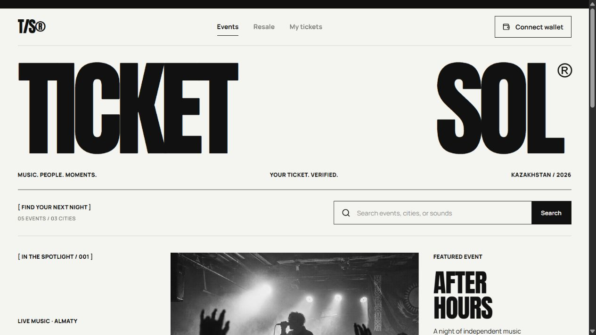
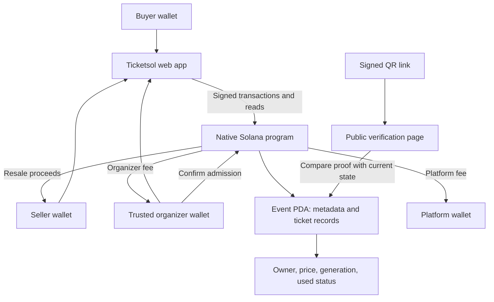

# Ticketsol — Your Ticket. Verified.

> Event tickets on Solana: buy from a trusted organizer, resell at or below face value, and verify the current ticket owner and admission status through a QR code.

[Live Demo](https://ticketsol.vercel.app) · [Documentation](docs/development.md) · [Pitch Deck](docs/Ticketsol-pitch.pptx) · [Program Source](program/Ticketsol.sol)



---

## Hackathon MVP

Ticketsol focuses on concert and festival audiences in **Almaty, Astana, and Shymkent, Kazakhstan**. The first user is a buyer who worries that a resale ticket may be fake or no longer valid.

| Name | Role | Contact |
| --- | --- | --- |
| yalubluroblox | Project maintainer | [GitHub](https://github.com/yalubluroblox) |

**Status:** English frontend and compiled Solana program. Seventeen integration checks passed on a local validator. Devnet program deployment still requires test SOL, so the app disables purchases until the program and event account are ready. The frontend is live on [Vercel](https://ticketsol.vercel.app). No hackathon submission form or walkthrough video has been published.

---

## Problem and Solution

### 1. A Screenshot Does Not Establish Ownership

- **Problem:** A buyer cannot easily tell whether the seller still owns a ticket or whether a copy has already been used.
- **Ticketsol:** The verification page checks a wallet signature against the current owner, ownership version, and admission status recorded on Solana.

### 2. Informal Resale Separates Payment From Delivery

- **Problem:** A buyer may send money without receiving a valid ticket.
- **Ticketsol:** The program transfers payment and ticket ownership in the same transaction. If a required check fails, the transaction does not complete.

### 3. Resale Prices Can Exceed Face Value

- **Problem:** Uncontrolled resale can make tickets more expensive for fans.
- **Ticketsol:** The MVP caps listings at the original ticket price. Each resale allocates 93% to the seller, 5% to the organizer, and 2% to the platform.

### 4. An Old QR Can Circulate After a Sale

- **Problem:** A previous owner may keep a copy of their ticket.
- **Ticketsol:** Every resale changes the owner and increments the ticket version, invalidating the previous owner's signed QR. Only the trusted organizer can confirm admission, and the program rejects repeat admission.

**Demand hypothesis:** The idea began with observed complaints on Threads. Customer interviews, market sizing, and willingness-to-use validation are still pending. A copied *current* QR can still be presented first; rotating QR and identity checks are outside this MVP.

---

## Why Solana

- **Shared ticket state:** Buyers and organizers read the same ownership and admission records.
- **Program-enforced rules:** The program checks signers, ticket capacity, resale price, fee recipients, and admission permissions.
- **Atomic settlement:** Payment and ownership change together, including the resale fee split.
- **Wallet signatures:** Phantom signs transactions and admission proofs. A public verification page can check a proof without connecting a wallet.

Solana is the ownership and payment core. The frontend targets **Devnet test SOL only**. The program uses custom program-owned ticket records, not SPL NFTs. Its Solidity source compiles with Solang to a native Solana SBF program, not an EVM contract.

---

## Summary of Features

- English, responsive interface with monochrome concert artwork.
- Five demo events across three cities.
- Search by event name, city, venue, or genre.
- Large featured poster with a compact event list below it.
- Phantom wallet connection and primary purchase interface.
- Resale listings with a face-value price cap.
- Atomic ownership transfer with a 93/5/2 fee split.
- My tickets, signed QR generation, and public verification route.
- Trusted organizer admission tools and rejection of used tickets.
- Actual deployment-state checks, without simulated purchases or transaction confirmations.

Only **After Hours** maps to the prototype's single on-chain event. Electric Steppe, Jazz After Dark, South Side Live, and Midnight Frequency are catalog previews marked **Coming soon**.

---

## Tech Stack

| Layer | Technology |
| --- | --- |
| Solana program | Solidity via Solang 0.3.3, native Solana SBF |
| Client | TypeScript, Anchor 0.28, `@solana/web3.js` |
| Wallet | Phantom |
| Frontend | React, Next.js, Tailwind CSS, Radix UI |
| Admission proof | Ed25519 wallet signatures, QR codes |
| Hosting configuration | Vercel |
| Validation | Local Solana validator integration checks, TypeScript, production build |

---

## Architecture



Configured program address: [`F8B453fWqji2qE6MfLjsQMmmzp9PJDNmLdudrQsoXCuP`](https://explorer.solana.com/address/F8B453fWqji2qE6MfLjsQMmmzp9PJDNmLdudrQsoXCuP?cluster=devnet). This is a configured address, **not a claim of successful Devnet deployment**.

See the [development guide](docs/development.md) for account addresses, contract checks, deployment instructions, and the full demo sequence.

---

## Quick Start

**Prerequisites:** Node.js 22 and npm. No private keys or environment variables are required to browse the frontend. Transactions require Phantom, Devnet SOL, and a deployed, initialized program.

```sh
git clone https://github.com/yalubluroblox/ticketsol.git
cd ticketsol
npm ci
npm run dev
```

```sh
# Validate and build
npm run typecheck
npm run build:vercel

# Serve the production build
npm start
```

For Vercel, import this repository with the **Next.js** framework preset and the repository root as the root directory. `vercel.json` supplies the install and build commands. The deployment needs no private keys.

Contract validation requires Solang, a local Solana validator, and dedicated local test keypairs. Cloning this repository does not provide the signing keys for its configured program or organizer. Read the [development guide](docs/development.md) before running contract scripts.

---

## Roadmap

- [x] Build the English catalog, search, and responsive poster layout.
- [x] Implement purchase, capped resale, fee distribution, and admission rules.
- [x] Implement signed QR verification and invalidate old proofs after resale.
- [x] Pass 17 local-validator integration checks.
- [x] Prepare the ten-slide English pitch deck.
- [x] Publish and verify the Vercel deployment.
- [ ] Fund and deploy the program to Solana Devnet.
- [ ] Demonstrate the full purchase, resale, and admission flow on Devnet.
- [ ] Validate demand and pilot with one trusted organizer.
- [ ] Add multiple on-chain events, refunds, and stronger QR protection.
- [ ] Complete an independent security review before real payments or mainnet.

---

## Resources

- [Live Application](https://ticketsol.vercel.app)

- [Source Code](https://github.com/yalubluroblox/ticketsol)
- [Development Documentation](docs/development.md)
- [English Pitch Deck — 10 Slides](docs/Ticketsol-pitch.pptx)
- [Project Overview — Russian PDF](docs/Ticketsol-overview-ru.pdf)
- [Solana Program Source](program/Ticketsol.sol)
- [Local Contract Validation Results](program/test-results.json)
- **Video Demo / Hackathon Submission URL:** Not yet published.

**Demo scope:** Test SOL only. One on-chain event, up to 64 tickets, and a 0.1 SOL face value. No card payments, seat maps, refunds, offline admission, or security audit. The app displays current ticket state; transaction history can be inspected separately on Solana. Event images are generated illustrations, not photographs of actual announced events.

---

## License

No repository-wide license has been selected. Existing source-file notices and bundled third-party licenses remain in their respective files.


